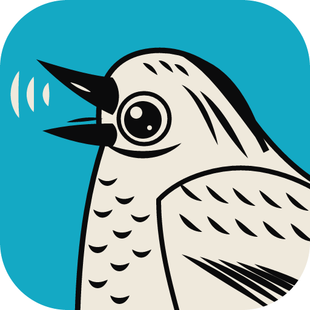

<p align="center"></p>

<h1 align="center">SoundCraft MCP Server</h1>

<p align="center">
  <a href="README.md">English</a> · <a href="README.es.md">Español</a> · <a href="README.pt-BR.md">Português</a> · <a href="README.fr.md">Français</a> · <a href="README.de.md">Deutsch</a> · <a href="README.ru.md">Русский</a> · <a href="README.zh-CN.md">简体中文</a> · <b>日本語</b> · <a href="README.ko.md">한국어</a>
</p>

<p align="center">
  お使いのコンピューターにインストールされた <b>SoundCraft</b> で、Claude に音楽と音声を作らせましょう — <b>Windows、macOS、Linux</b>：<br>
  オーディオファイルとシンセやドラムのノートからのマルチトラック曲、エフェクトとバス、ラウドネス付きのミックスダウン、ステム、MIDI、音声の加工と変換。
</p>

---

## なぜ

[SoundCraft](https://github.com/storytold/soundcraft) はオープンソースの Pro Tools クラスのデジタルオーディオワークステーションで、画面なしの CLI（`soundcraft-cli`）、469 のコマンド、27 の内蔵プラグイン（EQ、ダイナミクス、リバーブ、ディレイ、モジュレーション、シンセ、ドラムシンセ、サンプラー）、MCP モードを備えています。この [Model Context Protocol](https://modelcontextprotocol.io) サーバーはそのエンジンを Claude 用の **「ファイルを入れてファイルを出す」ツール**に変えるので、次のように頼めます：

> *「110 BPM・イ短調で 8 小節のドラムとベースのループを作って、WAV、ステム、MIDI を書き出して。」*
> *「この声をこの音楽に乗せてポッドキャストのイントロにして：声の下に音楽、フェード、声にコンプレッサー、-16 LUFS。」*
> *「`D:\インタビュー` の録音をすべて -1 dBFS にノーマライズし、最初の 2 秒をカットして 16 ビット FLAC で保存して。」*
> *「このサンプルを 3 半音上げて、音程を変えずに 50 % 長くして。」*
> *「このマスターの音量は（LUFS、トゥルーピーク）？波形を見せて。」*

姉妹プロジェクト： [designcraft-mcp-server](https://github.com/jhonsu01/designcraft-mcp-server), [effectcraft-mcp-server](https://github.com/jhonsu01/effectcraft-mcp-server), [lightcraft-mcp-server](https://github.com/jhonsu01/lightcraft-mcp-server), [photocraft-mcp-server](https://github.com/jhonsu01/photocraft-mcp-server), [vectorcraft-mcp-server](https://github.com/jhonsu01/vectorcraft-mcp-server), [filmcraft-mcp-server](https://github.com/jhonsu01/filmcraft-mcp-server), [pdfcraft-mcp-server](https://github.com/jhonsu01/pdfcraft-mcp-server), [wordcraft-mcp-server](https://github.com/jhonsu01/wordcraft-mcp-server), [deckcraft-mcp-server](https://github.com/jhonsu01/deckcraft-mcp-server), [gridcraft-mcp-server](https://github.com/jhonsu01/gridcraft-mcp-server)、[audacity-mcp-server](https://github.com/jhonsu01/audacity-mcp-server).

## 対応プラットフォーム

| OS | インストールする SoundCraft パッケージ | サーバーが探す場所（設定不要） | 状態 |
| --- | --- | --- | --- |
| **Windows** 10/11（x64、x86、arm64） | MSI またはポータブル zip | `C:\Program Files\SoundCraft`、`%LOCALAPPDATA%\Programs\SoundCraft`、`PATH` | ✅ 検証済み（Windows 11） |
| **Linux**（x86_64、aarch64） | `.deb`、`.rpm` または `.tar.gz` | `/usr/bin`、`/usr/local/bin`、`/opt/soundcraft/bin`、`~/.local/bin`、`PATH` | ✅ 検証済み（Debian 12、画面なし） |
| **macOS** 11+（Apple シリコンと Intel） | `.dmg`（アプリ）**に加えて** `soundcraft-cli-<バージョン>-macos-universal.zip` | `/Applications/SoundCraft.app`、`/usr/local/bin`、`/opt/homebrew/bin`、`~/.local/bin`、`~/bin`、`PATH` | 🟡 対応済み、Mac では未検証 |

ダウンロード：[SoundCraft のリリース](https://github.com/storytold/soundcraft/releases)（FreeBSD 用の tar.gz もあります。`SOUNDCRAFT_DIR` で指定してください）。それ以外の場所なら `SOUNDCRAFT_DIR`（フォルダー、`.tar.gz` のルート、`SoundCraft.app`）または `SOUNDCRAFT_CLI` を設定します。

- **macOS：** DMG にはアプリしか入っていません。別配布の `soundcraft-cli` の zip を展開し、`soundcraft-cli` を `/usr/local/bin` に移動してください（または `SOUNDCRAFT_CLI` で指定）。初回起動時に Apple の公証がオンラインで確認されます。
- **Linux：** AppImage と Flatpak にはアプリしか入っておらず、`soundcraft-cli` は含まれません。deb、rpm、tar.gz を使ってください。アプリが AppImage の場合は、`open_in_soundcraft` が起動できるよう `SOUNDCRAFT_APP` を設定します。GPU のないサーバーでの検証環境では `libxkbcommon0 libvulkan1 libegl1 mesa-vulkan-drivers libasound2 fontconfig` を使いました。

## 仕組み

| 構成要素 | 内容 |
| --- | --- |
| **SoundCraft エンジン**（`soundcraft-cli mcp`） | SoundCraft 自身のエンジン：トラック、クリップ、MIDI、内蔵プラグイン、ミキサー、バス、オートメーション、AudioSuite 処理、WAV / AIFF / FLAC / MIDI / .scraft の書き出し。ジョブごとに新しく**画面なし**で起動するため、SoundCraft アプリやオーディオデバイスには一切触れません。 |
| **MCP サーバー**（Node.js） | 10 の高レベルツール。シンプルな記述（トラック、秒で指定するクリップ、拍で指定するノート、エフェクト、センド）からセッションを組み立て、出力を事前に確認し、ミックスを測定し（ピーク、トゥルーピーク、統合 LUFS）、結果の**波形画像**を描いてアシスタントが確認できるようにします。 |
| **ライブアプリ**（任意） | `open_in_soundcraft control=true` はローカル専用の制御チャネル（ポート 7801）付きでアプリを起動し、`run_soundcraft_commands live=true` で操作します。終わったらアプリを閉じてください。 |

## ツール

| ツール | 機能 |
| --- | --- |
| `create_session` | マルチトラックセッション：任意の時間に置いたファイルのオーディオトラック（クリップゲイン、フェード）、減算シンセ・General MIDI ドラムシンセ・サンプラーが拍単位のノートを演奏するインストゥルメントトラック（ループ可）、MIDI ファイル、ボリューム、パン、ミュート、ソロ、インサートエフェクト、AUX バスへのセンド、テンポ、拍子、キー、マーカー。ミックスダウン、ステム、MIDI、.scraft セッションを書き出し、ピーク・LUFS・波形を返します |
| `edit_session` | .scraft セッションの変更：テンポ、拍子、キー、マーカー、バス、新しいトラック、既存トラックの名前変更・再ミックス・エフェクトとセンドの追加・削除。新しいコピーとミックスダウンとして保存 |
| `export_session` | 1 つのセッション、リスト、またはフォルダー → WAV / AIFF / FLAC ミックスダウン（範囲、ノーマライズ、ビット深度）、ステム、MIDI、ラウドネス付き |
| `process_audio` | オーディオファイル（1 つ、リスト、フォルダー）：トリム、ノーマライズ、ゲイン、リバース、極性反転、ピッチシフト、タイムストレッチ、バリスピード、エフェクト、フェード、ボリュームとパン → WAV、AIFF、FLAC |
| `convert_audio` | オーディオファイル → WAV、AIFF、FLAC、サンプルレート、ビット深度、ノーマライズ |
| `get_audio_info` | オーディオファイルの形式、チャンネル、レート、ビット深度、長さ、またはセッションのトラック。任意でラウドネス（ピーク、トゥルーピーク、LUFS）と波形 |
| `list_soundcraft_catalog` | 469 のコマンド、27 のプラグインとすべてのパラメーター（id、範囲、単位）、ドラムのノート名、形式 |
| `run_soundcraft_commands` | 任意のエンジンコマンドと `import_audio`、`inspect_session`、`bounce_mix`... を 1 つのセッションで実行（`$steps[N].フィールド` 参照）、画面なしまたはライブで実行して出力を書き出し |
| `open_in_soundcraft` | SoundCraft アプリでセッション（またはデモ曲）を開く（制御チャネル付きも可） |
| `get_soundcraft_status` | プラットフォーム、インストール、バージョン、コマンド、プラグイン、Pro Tools の対応度、アプリ / 制御ポート |

| | |
| --- | --- |
| **読み込み** | WAV、AIFF、FLAC、MP3、OGG、M4A/AAC、ALAC、CAF、スタンダード MIDI ファイル、.scraft セッション |
| **書き出し** | WAV、AIFF、FLAC（16 / 24 ビット、32 ビット浮動小数点）、ステム、MIDI、.scraft セッション（音声は「Audio Files」にコピー） |

時間は**秒**、ノートはクリップの先頭からの**拍**（4 分音符）で指定します。音の高さは MIDI 番号、`C4` / `F#3` / `Bb2` のような名前、または `drum_synth` なら `kick`、`snare`、`clap`、`hat`、`open_hat`、`low_tom`、`mid_tom`、`high_tom`、`crash`、`ride`。

## 例

```json
{
  "name": "Night drive",
  "tempo": 100,
  "key": "A minor",
  "busses": [{ "name": "Verb", "effects": [{ "plugin": "plate_reverb", "params": { "mix": 30 } }] }],
  "markers": [{ "name": "Intro", "at": 0 }, { "name": "Chorus", "at": 9.6 }],
  "tracks": [
    { "type": "instrument", "name": "Drums", "instrument": "drum_synth", "bars": 1, "repeat": 8,
      "notes": [{ "pitch": "kick", "start": 0 }, { "pitch": "hat", "start": 0.5, "length": 0.5 }, { "pitch": "snare", "start": 1 },
                { "pitch": "hat", "start": 1.5, "length": 0.5 }, { "pitch": "kick", "start": 2 }, { "pitch": "snare", "start": 3 }] },
    { "type": "instrument", "name": "Bass", "volume_db": -4, "pan": -0.2, "sends": [{ "bus": "Verb", "level_db": -14 }],
      "notes": [{ "pitch": "A1", "start": 0, "length": 2 }, { "pitch": "F1", "start": 2, "length": 2 }], "repeat": 4 },
    { "type": "audio", "name": "Voice", "files": [{ "path": "C:\\Audio\\voice.wav", "at": 4.8 }], "fade_in": 0.3, "fade_out": 1,
      "effects": [{ "plugin": "eq_7band", "params": { "hpf_on": 1, "hpf_freq": 90 } }, { "plugin": "compressor", "params": { "threshold": -18, "ratio": 3 } }] }
  ],
  "formats": ["wav", "stems", "mid", "scraft"],
  "normalize": true,
  "output_dir": "C:\\Music"
}
```

## 必要なもの

- `soundcraft-cli` 付きの **SoundCraft**（**0.6.1** で検証）。[対応プラットフォーム](#対応プラットフォーム)を参照
- Node.js ≥ 20（`.mcpb` でインストールする場合は Claude Desktop に同梱）

## インストール

### Claude Desktop（推奨、全プラットフォーム）

1. [最新リリース](https://github.com/jhonsu01/soundcraft-mcp-server/releases/latest)から `soundcraft-mcp-server.mcpb` をダウンロードします。
2. ダブルクリック（または Claude Desktop → *設定 → 拡張機能* にドラッグ）して **インストール** をクリックします。
3. 任意：SoundCraft が標準の場所にない場合は、拡張機能の設定でそのフォルダーか `soundcraft-cli` のパスを入力します。

### Sunsam Code

[Sunsam Code](https://github.com/jhonsu01/marketplace-SunsamCode) のマーケットプレイスから **SoundCraft Bridge** をインストールするか、`.mcpb` を *MCP → 拡張機能をインストール* にドロップします。

### Codex（OpenAI）

**推奨 — マーケットプレイス（更新を受け取れます）：** *プラグイン → 追加 → マーケットプレイスを追加* で、ソースに `jhonsu01/craft-marketplace`、参照に `main` を指定し、**Craft Bridges** から **SoundCraft Bridge** をインストールします（[craft-marketplace](https://github.com/jhonsu01/craft-marketplace)）。新しいバージョンはマーケットプレイスの更新で届きます。または zip をアップロードします（Codex はアカウントに保存し、同じ名前の新しい zip を拒否します）：

1. [最新リリース](https://github.com/jhonsu01/soundcraft-mcp-server/releases/latest)から `soundcraft-mcp-server-<バージョン>-codex.zip` をダウンロードします。
2. Codex で *プラグイン → 追加 → 新しいプラグイン* を開き、zip を選んで **プラグインを追加** をクリックします。
3. Codex はサーバーを `node` で起動するため、`PATH` に Node.js ≥ 20 が必要です。SoundCraft が標準の場所にない場合は、`SOUNDCRAFT_DIR` または `SOUNDCRAFT_CLI` をシステムの環境変数として設定してください（Codex にはローカルプラグイン用の設定画面がありません）。

### DeepSeek Harness

1. *Plugins → Add plugin* で `github:jhonsu01/craft-marketplace#path:/plugins/soundcraft-mcp-server` を入力し、**Install**、続けて **Enable now** をクリックします。
2. Harness は独自の MCP クライアントと `node`（`PATH` に Node.js ≥ 20 が必要）でサーバーを起動します。ツールは `mcp__soundcraft__<ツール>` として表示され、出力ファイルは Harness で開けるカードになります。
3. Harness はまだプラグインを自動更新しません。更新するには、プラグインをアンインストールして同じアドレスで再インストールしてください。

### Claude Code / その他の MCP クライアント

```bash
git clone https://github.com/jhonsu01/soundcraft-mcp-server.git
cd soundcraft-mcp-server
npm install
npm run build
```

Windows：

```bash
claude mcp add soundcraft -- node "%CD%\dist\bundle.cjs"
```

macOS / Linux：

```bash
claude mcp add soundcraft -- node "$PWD/dist/bundle.cjs"
```

## 設定

| 変数 | 意味 |
| --- | --- |
| `SOUNDCRAFT_DIR` | SoundCraft のフォルダー、その実行ファイルのいずれか、`.tar.gz` のルート（`bin/` を含む）または `SoundCraft.app`。既定：自動検出 |
| `SOUNDCRAFT_CLI` | `soundcraft-cli` / `soundcraft-cli.exe` のパス（`SOUNDCRAFT_DIR` より優先） |
| `SOUNDCRAFT_APP` | デスクトップアプリが別の場所にある場合のパス（例：Linux の AppImage） |
| `SOUNDCRAFT_CONTROL_PORT` | デスクトップアプリの制御ポート（既定 7801） |
| `SOUNDCRAFT_MCP_TIMEOUT` | エンジン呼び出し 1 回あたりの最大秒数（既定 3600） |

## 安全性

- `overwrite: true` でない限りファイルは**上書きされません**：フォルダーでは空いている名前（`_2`）を使い、既存の `output_path` はエラーになります。入力は読み取るだけで、編集したファイルは新しいコピー（`_edited`）としてのみ保存されます。
- パスはすべて絶対パスで指定します。エンジンは画面なしで動き、`live: true` でない限り SoundCraft アプリには触れません。
- すべてローカルで実行され、ネットワークにはアクセスしません。ジョブごとに専用のエンジンを一時フォルダーで動かし、最後に削除します。

## 開発

```bash
npm run build       # TypeScript + 単一ファイルのバンドル（dist/bundle.cjs）
npm test            # ユニットテスト（Windows、macOS、Linux のパス処理）
npm run test:e2e    # 実際の MCP stdio による 27 のエンドツーエンドチェック（`E2E_LIVE=1` で 29、合成オーディオ）
npm run pack:mcpb   # soundcraft-mcp-server.mcpb
npm run pack:codex  # Codex / DeepSeek Harness 用プラグイン zip
```

Docker での Linux テスト（先に `soundcraft-<バージョン>-linux-x86_64.tar.gz` を展開）：

```bash
docker run --rm -v "$PWD:/work:ro" -v "/path/to/soundcraft-0.6.1-linux-x86_64:/opt/soundcraft:ro" -e SOUNDCRAFT_DIR=/opt/soundcraft -w /work node:22-bookworm bash -c "apt-get update && apt-get install -y libxkbcommon0 libvulkan1 libegl1 mesa-vulkan-drivers libasound2 fontconfig && node scripts/e2e.mjs"
```

## ライセンス

Apache-2.0。SoundCraft の著作権はその作者（Storytold）に帰属し、MIT または Apache-2.0 で提供されています。
本プロジェクトは SoundCraft および Storytold とは無関係であり、承認も受けていません。Pro Tools は Avid の商標です。
